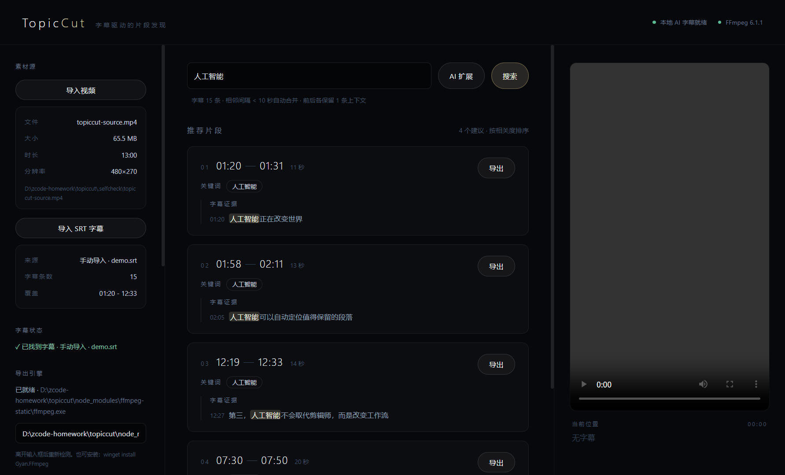
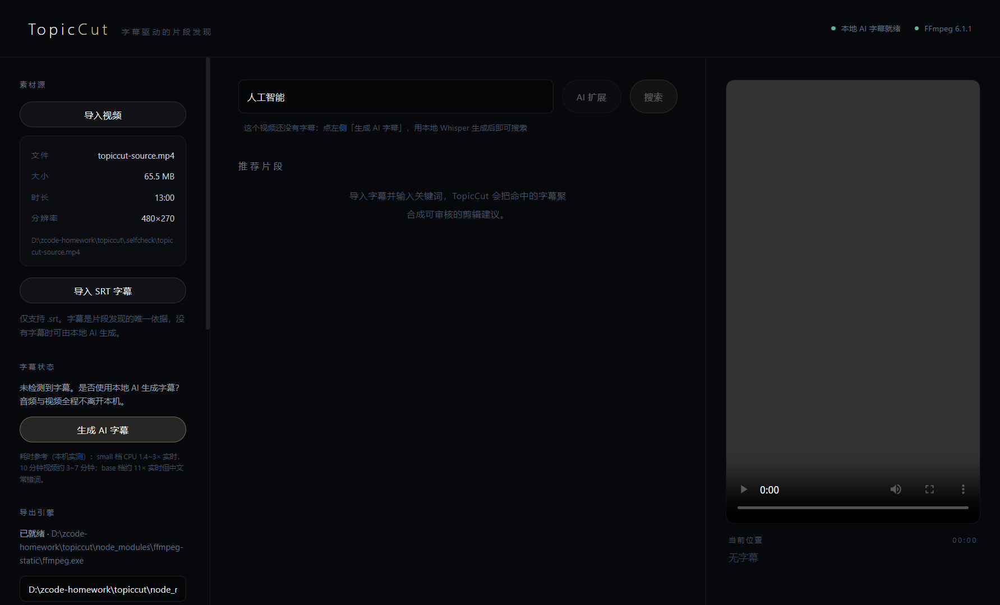
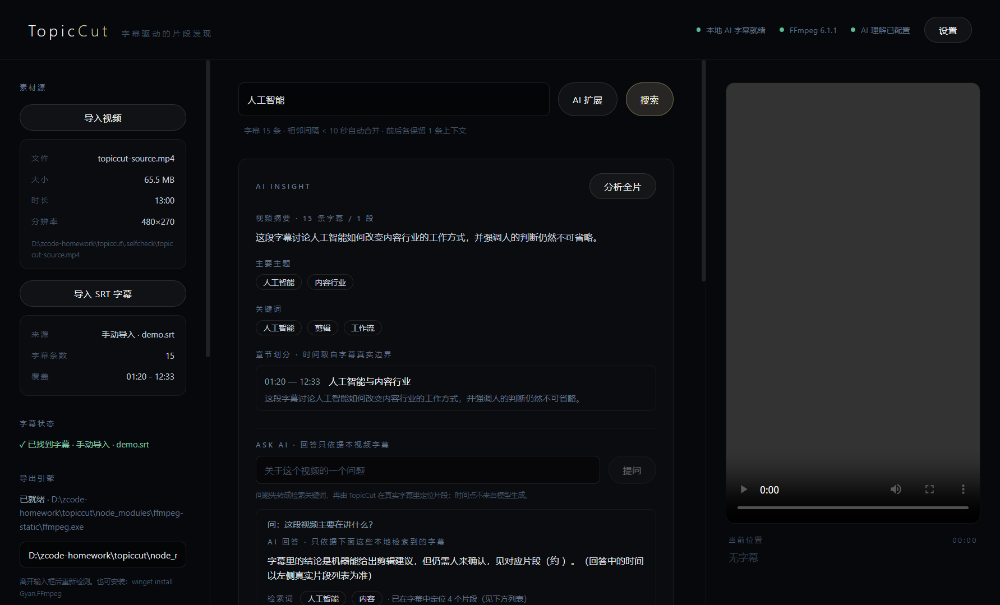
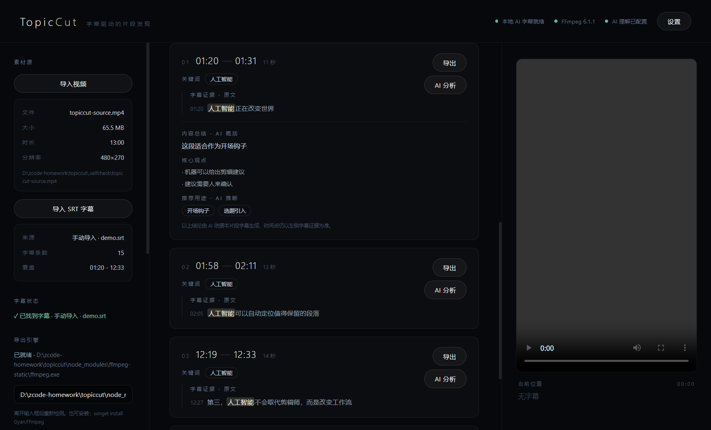
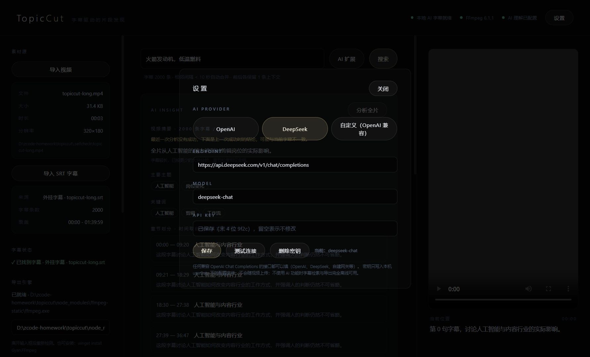
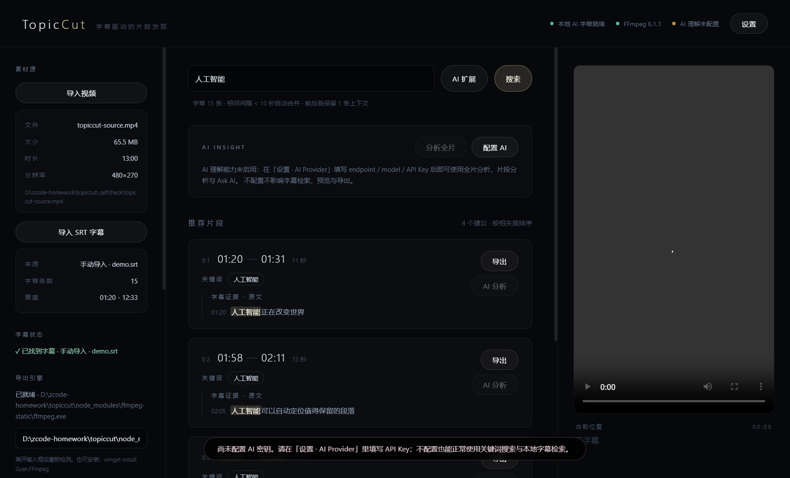
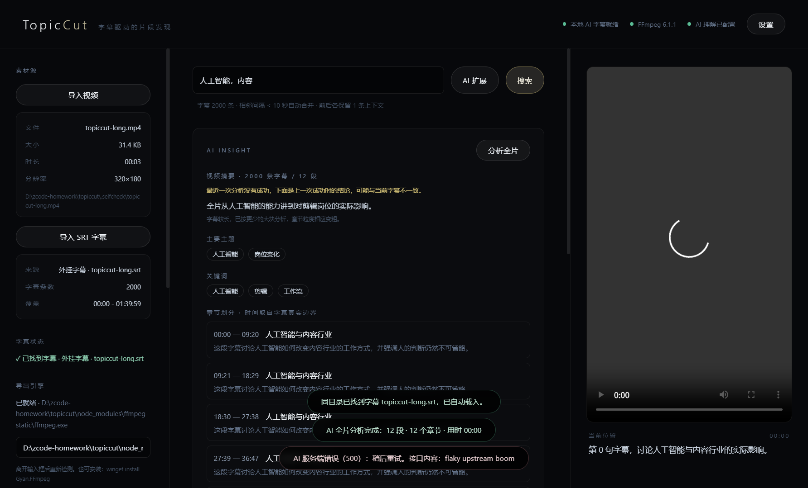

# TopicCut

> 字幕驱动的视频片段发现工具 · Subtitle-driven clip discovery for long-form video
>
> **1.1**：没有字幕也能用 —— 本机 Whisper.cpp 生成 SRT，检索与导出链路不变。
> **1.5**：字幕读不完也能用 —— AI Insight 给出摘要 / 主题 / 关键词 / 章节，但**时间轴永远来自本地字幕检索**。
> **1.5.0 起提供 Windows 安装包**：`TopicCut-Setup-1.5.0.exe` 双击安装，桌面/开始菜单启动，随包带 FFmpeg 与 whisper-cli，用户机器不需要 Node —— 安装、许可与验收见 §9。

**一句话**：把「在这期 90 分钟的视频里找出讲 X 的段落」这件事，从人工拖时间轴，变成 **（无字幕先本地转写）→ 搜索 → 看字幕证据 → 一键确认导出**。



---

## 1. 项目定位

| | |
|---|---|
| **解决的问题** | 长视频（会议、访谈、课程、播客视频版）内容不可检索，剪辑师/运营需要逐秒拖进度条找素材 |
| **产品形态** | 桌面应用（不是网页、不是插件），本地处理，**不上传视频**；1.5 的 AI 分析只把**字幕文本**发往用户自己配置的接口，视频与音频永不出机器，不配 Key 时零出网 |
| **核心洞察** | 字幕是视频内容最廉价、最结构化的语义索引。**不需要理解视频，只需要理解字幕文本 + 时间轴** |
| **刻意不做** | 时间轴编辑器、多轨剪辑、转场特效、云端转写、语义向量检索 |
| **目标用户** | 内容运营、剪辑助理、知识区 UP 主、需要做素材检索的团队 |
| **MVP 边界** | 单视频 + 单 SRT + 关键词检索 + 流复制导出；1.1 补上"无字幕时本机转写"这一条前置，1.5 补上"读不完字幕时让 AI 先读一遍"（只读，不改媒体链路） |

设计取舍：**宁可功能窄，也要闭环真能跑**。所有环节都可解释、可验证 —— 每个推荐片段都能回答"为什么推荐它"（字幕证据 + 时间戳）。

---

## 2. 架构

```
┌────────────────────────────  Electron 进程模型  ────────────────────────────┐

│  主进程 (Node.js)                                渲染进程 (React + TS)      │
│  electron/main.cjs                               src/pages/WorkbenchPage    │
│  ├─ 文件对话框 / 保存路径确认                      ├─ 状态编排 · 流程控制    │
│  ├─ SRT 编码嗅探 (UTF-8 fatal → GBK 回退)          ├─ src/utils/srt.ts       │
│  ├─ topiccut-media:// 协议 → 本地视频可播放        │   时间轴 → 秒            │
│  └─ IPC (contextBridge 白名单)                    ├─ src/utils/clips.ts     │
│      electron/preload.cjs                         │   命中→合并→上下文→打分  │
│        │                                          └─ src/services/*         │
│        ▼                                             调用桥接 API            │
│  electron/services/ffmpeg.cjs                                                    │
│  ├─ detect()   多候选路径探测 + 真实执行 -version 校验                            │
│  ├─ probe()    ffprobe 元信息，缺失时回退解析 ffmpeg -i                            │
│  └─ exportClip() spawn ffmpeg -ss/-to/-c copy + 进度解析                          │
│  electron/services/subtitles.cjs  ← 1.1 同目录/内嵌字幕探测 + 提取                 │
│  electron/services/whisper.cjs    ← 1.1 抽音轨 + spawn whisper-cli + 进度/取消     │
│  electron/services/ai.cjs         ← 1.5 唯一的出网入口：分块 / 超时 / 错误归因 /   │
│                                      防幻觉（模型只出文字，时间轴由本地检索给）    │
│        │                                                                        │
└────────┼────────────────────────────────────────────────────────────────────────┘
         ▼
   系统 FFmpeg / whisper.cpp CLI ──► SRT 字幕 · .mp4 片段（流复制，不重编码）
   用户自填的 OpenAI 兼容接口 ──────► AI Insight 文字结论（1.5，可选，不出本机也可禁用）
```

**数据流（一次完整闭环）**

```
视频文件 ─┐
          ├─► 字幕解析 cues[{start,end,text}]
SRT 文件 ─┘        │
                   ▼
          关键词命中 matched[]      ← 忽略大小写/空格，多关键词 OR
                   │
                   ▼
          相邻命中合并 (间隔 < 10s)  ← 时间紧邻才补上下文
                   │
                   ▼
          候选片段 clips[{start,end,evidence,score}]
                   │
                   ▼
          UI 展示字幕证据 → 用户点击确认 → 选择保存路径
                   │
                   ▼
          ffmpeg -ss start -to end -i in.mp4 -c copy out.mp4
```

---

### 代码结构

```
topiccut/
├─ electron/                     # 主进程：所有特权能力
│  ├─ main.cjs                   # 窗口 · IPC · topiccut-media:// 协议 · 演示与自检通道
│  ├─ preload.cjs                # contextBridge 白名单（渲染层拿不到 Node）
│  └─ services/
│     ├─ ffmpeg.cjs              # detect / probe / exportClip / buildExportArgs
│     ├─ subtitles.cjs           # SubtitleDetector：同目录 · 内嵌流探测 · 提取
│     ├─ whisper.cjs             # WhisperService：CLI/模型探测 · 抽音轨 · 转写 · 进度 · 取消
│     ├─ ai.cjs                  # 1.5 唯一的出网入口：配置归一 · 分块 · 超时 · 错误归因 · 防幻觉
│     └─ settings.cjs            # userData 下的 JSON 配置
├─ src/
│  ├─ pages/WorkbenchPage.tsx    # 工作台：状态与流程编排
│  ├─ components/                # Header · SourcePanel · SearchBar · ClipList · ClipCard · PlayerPane · Toast
│  │                             # 1.5：InsightPanel（AI Insight + Ask AI）· SettingsPanel（AI Provider）
│  ├─ services/                  # bridge · sourceService · exportService · whisperService · aiService
│  ├─ utils/                     # srt.ts 解析 · clips.ts 聚合算法 · format.ts
│  └─ types/index.ts             # 共享类型 + window.topiccut 声明
├─ scripts/
│  ├─ check-logic.ts             # 127 条核心断言，纯 Node，无需 Electron
│  ├─ verify-export.mjs          # 真实 FFmpeg 导出闭环验证
│  ├─ verify-subtitles.mjs       # 真实字幕探测/提取 + 转写进程控制验证
│  ├─ verify-flow.mjs            # 字幕来源生命周期 4 场景（demo/内嵌/无字幕/同目录）
│  ├─ verify-ai.mjs              # 1.5 本地 mock AI 接口 + 真实界面动作端到端
│  ├─ verify-real-asr.mjs        # 真实 whisper.cpp 端到端（转写→检索→导出）
│  └─ find-ffmpeg.mjs            # 扫描本机可用 ffmpeg
├─ samples/demo.srt              # 15 条演示字幕
├─ docs/screenshot.png · screenshot-ai-prompt.png · screenshot-ai-insight.png · screenshot-ai-clip.png · screenshot-ai-settings.png
└─ README.md · LICENSE
```

---

## 3. TopicCut 1.1 · 本地 AI 字幕（无字幕也能用）

1.0 的前提是"用户已经有字幕"。1.1 把这个前提去掉：**只拖一个视频进来**，没有字幕时由本机 Whisper 生成，然后继续走完全相同的检索链路。

```
                    ┌──────────── 导入视频 ────────────┐
                    ▼                                  │
        SubtitleDetector（electron/services/subtitles.cjs）
        ├─ 同目录 .srt（movie.mp4 → movie.srt / movie.zh.srt）
        └─ 内嵌字幕流（ffmpeg -i 解析 Stream #0:x: Subtitle）
                    │                                  │
        有 ─────────┤                                  │
        │  同目录：自动载入                             │
        │  内嵌：一键提取为 .srt（-map 0:x -c:s srt）   │
        ▼                                              │
   继续 1.0 检索链路 ◄───────────────────────────────────┘
        │
        无 ──► 提示「未检测到字幕，是否使用本地 AI 生成字幕？」
                │ 用户确认
                ▼
        WhisperService（electron/services/whisper.cjs）
        ├─ 1. 前置检查：无音轨直接报错，不白跑几十分钟
        ├─ 2. ffmpeg 抽音轨 → 16 kHz 单声道 wav（临时目录）
        ├─ 3. spawn whisper-cli -m ggml-*.bin -f audio.wav -osrt
        │      ├─ 解析 `progress = A / B secs ( R x)` → 百分比 + 预计剩余
        │      └─ 任意时刻可取消（kill 子进程，任务态标 cancelled）
        └─ 4. 产出 <视频名>.generated.srt → 自动载入 → 回到检索链路
```

**硬性约束（按产品定位刻意保留）**

| 约束 | 实现 |
|---|---|
| 不修改检索核心 | `clips.ts` / `srt.ts` 一行未动；Whisper 只负责"声音 → SRT"，产出后走原解析器 |
| 离线、本地优先 | 转写全程在本机子进程，无网络请求；视频/音频不出机器 |
| 不上传视频 | **转写全程不碰网络**；应用里唯一会出网的是用户自配的 AI 接口（1.0 关键词扩展、1.5 AI Insight），送的也只有字幕文本 |
| 不自动下载大模型 | 只探测已安装的 whisper-cli 与 `ggml-*.bin`；缺失时给出下载指引，不偷偷拉 1 GB 文件 |
| 不阻塞主进程 | 全部通过 `child_process.spawn` + 事件回传，UI 保持可交互 |

### 安装 whisper.cpp（免编译，实测 3 分钟）

```bash
# 1) 拿 whisper-cli：GitHub → whisper.cpp 的 Releases 里选最新带版本号的资产（如 b5454），
#    下载 whisper-bin-x64.zip（约 9 MB），解压出来就是 Release/whisper-cli.exe + 一串 dll，无需 cmake/编译器。
#    解压到 %LOCALAPPDATA%\Programs\whisper.cpp\ 即可被自动发现（同目录的 dll 不要单独挪走）。

# 2) 下模型（选一个档位即可，放到 ~/.cache/whisper.cpp/ 就能自动发现）
#    https://huggingface.co/ggerganov/whisper.cpp/resolve/main/ggml-small.bin   # 465 MB，中文推荐
#    国内网络可用镜像：https://hf-mirror.com/ggerganov/whisper.cpp/resolve/main/ggml-small.bin

# 3) 打开 TopicCut：左侧「AI 字幕 · 本地」两行都会变绿（whisper.cpp version: 1.9.5 / 模型 ggml-small.bin · 465 MB），
#    不用点「选择程序 / 选择模型」。放在别处时再用这两个按钮指定，路径写入本机 userData 配置。
```

自动发现位置（探测顺序）：设置里手填的路径 → `WHISPER_PATH` → `C:\whisper.cpp\build\bin\Release\` → `C:\Program Files\whisper.cpp\` → `%LOCALAPPDATA%\Programs\whisper.cpp\` → 项目内 `whisper.cpp\` → `PATH`；模型同理会找 `whisper-cli` 同级 `models\`、`~/.cache/whisper.cpp\`、`~/Downloads\`、`C:\whisper.cpp\models\`。

**每个候选都会真跑一次 `--help` 并校验输出形如帮助页**，因此"命令名存在但不可执行"不会被误判成已安装。

### 档位怎么选（本机实测，非官方数字）

同一段 **3 分钟真实中文电影音频**（`魔方小姐` 4K HEVC/AAC，国语对白），`whisper-cli -t 4`：

| 档位 | 文件 | 3 分钟音频耗时 | 相对实时 | 中文观感（同一句"你就是我的大救星"） |
|---|---|---|---|---|
| tiny | 74 MB | 15 s | 12× | `你就是我的大舊艇` — 繁体 + 错词 |
| base | 141 MB | 17 s | 11× | `你就是我的大丢型` — 大意在，专名/词全错 |
| **small** | 465 MB | 60 s | 3.0× | `你就是我的大救星` — 可懂，偶有错字 |

结论：**中文别用默认 base**。base/tiny 只适合"先粗粗定位"，能读通顺的检索要用 small 及以上。界面下拉框里已把这组实测数据写进选项说明，并在生成入口标了耗时参考。
（表里是独立 CLI 的纯推理倍率；应用内跑完整链路还要加抽音轨与界面开销，同一素材四次实测 **1.4~3.4 倍速**（见下面端到端记录），波动全部来自机器负载。medium 未实测：体积 1.5 GB、更慢，只标注为"更准但更慢"。）

### 使用流程

1. 导入视频 → 左侧「字幕状态」自动给出结论：`✓ 已找到字幕 · 外挂字幕 · movie.srt` / `检测到 N 条内嵌字幕` / `未检测到字幕`
2. 没有字幕时点 **生成 AI 字幕** → 显示「正在识别语音… 提取音轨 / 识别 · 35% · 预计剩余 03:21」，可随时取消
3. 完成后自动载入 `<视频名>.generated.srt`（来源标记为 `AI 生成`），若搜索框已有关键词则立即重查
4. 之后的证据展示、预览、导出与 1.0 完全一致
5. 下次再导入同一个视频：`*.generated.srt` 会被同目录探测捡回来，直接标成 `AI 生成 · xxx.generated.srt`，不会重复转写



### 验证

```bash
npm run verify:subtitles   # 16 条断言，真实 FFmpeg + 真实子进程
npm run verify:real-asr    # 真实 whisper.cpp 端到端：转写 → 检索 → 导出
```

`verify:subtitles` 覆盖：真实生成含内嵌字幕的 MKV 并探测出 `Stream #0:2 Subtitle`、提取回读得到 15 条字幕且首条起点 80 秒、同目录 `movie.srt` 匹配、无音轨视频被前置拦截、转写进程进度单调递增并产出 SRT、取消信号在 400 ms 内终止子进程并回「已取消。」、whisper-cli 缺失时给出可读提示。

> 说明：`verify:subtitles` 的进度/取消用**桩程序**（一个会打印 whisper 风格 `progress =` 行的 Node 脚本）驱动真实子进程，验证的是本项目的进程控制代码；真实模型驱动的产品级端到端见下面的 `verify:real-asr`。

#### 真实端到端（本机实测，2026-10-14）

环境：whisper.cpp **1.9.5**（预编译包，无编译）· `ggml-small.bin` · `ffmpeg 6.1.1` · 4 线程 · CPU 推理。
素材：`魔方小姐.It's.My.Time.2026` 正片 **25:00–35:00 的真实切片**（`-c copy`，240.5 MB，600.42 s，国语对白，无字幕、无内嵌字幕轨）。

```
$ npm run verify:real-asr
--- 0. 环境与素材
视频 魔方小姐.It's.My.Time.sample.mp4 · 240.5 MB
FFmpeg D:\zcode-homework\topiccut\node_modules\ffmpeg-static\ffmpeg.exe
whisper-cli C:\Users\<用户名>\AppData\Local\Programs\whisper.cpp\whisper-cli.exe
     whisper.cpp version: 1.9.5
模型 ggml-small.bin · 465 MB · C:\Users\<用户名>\.cache\whisper.cpp\ggml-small.bin

FLOW_PASS E whisper-cli 已被自动发现 → true
FLOW_PASS E ggml 模型已被自动发现 → true
FLOW_PASS E 真实视频无字幕 → false
FLOW_PASS E 有音轨，AI 入口可用 → true
FLOW_PASS E 点击「生成 AI 字幕」生效 → true
FLOW_PASS E 生成字幕文件名为 <视频名>.generated.srt → "魔方小姐.It's.My.Time.sample.generated.srt"
FLOW_PASS E 来源标记为 AI 生成 → "ai"
FLOW_PASS E 字幕非空 → true
FLOW_PASS E 进度单调递增且采样点充足 → true        # 2124 次采样
FLOW_PASS E 进度到达过 100% → true
FLOW_INFO E 转写耗时 330.6s，进度采样 2124 次
FLOW_INFO E 检索关键词 "赵奶奶传"
FLOW_PASS E 用生成字幕检索到候选片段 → true         # 2 个片段
FLOW_PASS E 片段末尾不超过视频长度 → true
FLOW_PASS E 导出产物存在 → true
FLOW_PASS E 导出时长与片段一致（流复制容差） → true
FLOW_INFO E 片段 357.6s→600.4s 导出 242.82s（偏差 0.00s）/ 96.98 MB
结果：27 通过 / 0 失败（截图 .selfcheck/realasr.png）
```

> 摘录里的 Windows 用户名已替换为 `<用户名>`，其余输出保持原样；`.selfcheck/` 是本地自检产物目录，不随仓库分发。

**记录**

| 项 | 值 |
|---|---|
| 模型 | whisper.cpp 1.9.5 + `ggml-small.bin`（465 MB），`-l zh -t 4` |
| 视频长度 | 600.42 s（真实电影切片，4K HEVC + AAC） |
| 转写耗时 | 600 s 音频 → **四次实测 175.0 s / 235.9 s / 330.5 s / 418.0 s**（含抽音轨），即 **1.4~3.4 倍速**；四次产出**完全一致**（296 条、同一检索词、同一导出、偏差 0.00 s），差异只来自机器负载。空闲机器上应用内跑分甚至略胜同机独立 CLI 的 3.0 倍速 —— 之前"应用内一定更慢"的判断是两次满载测出来的假象，故修正 |
| 产出字幕 | 296 条（约 2 s/条） |
| 检索 | 从生成字幕里自动取高频词「赵奶奶传」→ 2 个候选片段 |
| 导出 | 357.6–600.4 s → 242.82 s / 96.98 MB，时长偏差 0.00 s |
| 外推 | 整片 1:47:00（6420 s）用 small 约 **31~76 分钟**（按上表四次实测的倍率区间），用 base 约 **10~11 分钟**（推算，未跑完整片） |

**字幕质量（人工抽查，不做伪精确指标）**：大意可懂、时间轴对得上口型，但三类问题稳定复现：

1. **专名与口语错字**：`警花→警华`、`女士→女省`、`麻婆豆腐→美玛豆腐`、`大救星`偶尔`大舊艇`。检索结论：主题词命中没问题，但**逐字引用要人工校对**，不能直接当成片字幕用。
2. **简繁混排**：`-l zh` 下同一份字幕里前段偏繁体（`你叫多遠,你沒事吧`）、后段偏简体。这对字面检索是真实伤害 —— 应对方式就是已有的多关键词能力：`奶奶,奶媽,嬷` 一次搜多种写法。
3. **尾部补白**：whisper.cpp 最后一个 30 s 窗口会把结尾几段重复输出，且时间戳能**超出视频长度**（实测末条 00:10:06.6，而音频只有 600.4 s）。因此导出前必须把片段末尾截到视频实际长度（`clampClipRange()`，已被断言覆盖）——这是装了真实环境才暴露出来的 bug，桩程序永远测不到。


---

## 4. TopicCut 1.5 · AI Insight（让 AI 读字幕，不让 AI 找时间）

1.1 解决"没有字幕"，1.5 解决"有字幕但读不完"：15 条字幕可以直接搜，2 万条字幕没人能扫。
这一层**只读不写**，媒体链路一行未动 —— `clips.ts` / `srt.ts` / `ffmpeg.cjs` / Whisper 全流程保持原样，1.0/1.1 的断言仍然全绿。

```
字幕 cues
   │  按字符预算分块（只在字幕条目边界断开，绝不丢字幕）
   ▼
逐块 LLM ──► {章节名, 段摘要, 主题词, 搜索词}      ← 模型只出文字
   │
   ├─ 多块时再跑一次汇总 LLM ──► {全片摘要, 主要主题, 关键词}
   ▼
章节起止 = 该块字幕的真实首末时间戳（模型不参与）
   ▼
摘要 / 主题 / 关键词 / 章节  →  点章节跳时间、点关键词直接检索
```

### 四类能力

| 能力 | 输入 | 输出 | 时间从哪来 |
|---|---|---|---|
| 全视频分析 | 当前字幕全部 cues | 视频摘要、主要主题、关键词、章节划分 | 章节边界 = 字幕真实时间戳 |
| 片段分析 | 该 clip 已检索到的字幕 | 内容总结、核心观点、推荐用途 | 片段本就由本地检索定界 |
| Ask AI | 一句自然语言问题 | 回答 + 检索词 + 定位到的片段 | 问题 → 关键词 → **本地 `buildClips`** |
| AI 扩展（1.0 升级） | 搜索框里的一句主题 | 关键词数组 → 复用原检索 | 同上；调用改走主进程 |

### AI 配置

顶栏「设置」→ AI Provider：`endpoint` / `model` / `API Key` 三项全部由用户填写，**代码里没有任何硬编码密钥**。
OpenAI、DeepSeek 两个预置只是把默认地址和模型名填进输入框，改完仍可用；任何兼容 Chat Completions 的地址（自建网关、局域网 vLLM、`/v1/chat/completions` 全路径）都能填，`normalizeEndpoint()` 负责补齐。配置写入本机 `userData/topiccut-settings.json`。

**写入只有四个原始字段**：`mergeAiConfig()` 只合并 `provider / endpoint / model / apiKey`，派生值（`hasKey` / `keyTail` / `ready`）永不落盘 —— 否则配置文件里会留下一个说谎的 `hasKey`。输入框留空 = 保持原值，真正的撤销是设置页的「**删除密钥**」按钮（`clearApiKey`），删完 AI 入口立刻变灰且零出网，重新填写立刻恢复，不需要重启。

**进程边界**：AI 调用 100% 发生在主进程 `electron/services/ai.cjs`。渲染层只拿脱敏视图（`hasKey` + `keyTail` 末 4 位），密钥不回传、不进 DOM；自定义 endpoint 也因此不受渲染层 CORS 限制。接口报错时（401/400/连接失败）错误文本先过 `redactSecret()`，密钥原文一律替换成 `***` 再给界面。

### 四条硬约束（都有断言锁住）

1. **模型不产时间**。问答固定为"问题 → 关键词提取 → TopicCut 本地检索 → 返回真实片段"；章节时间取分块的字幕真实边界；答案文本再过一道 `scrubTimestamps()`，把模型自己写出的 `01:23` / `第 5 分钟` / `300 秒` 抹掉并指回真实片段列表。
2. **不丢内容**。`planChunks()` 在块数超过上限时**递发放大预算重切**（循环放大到真的落进上限，界面同步标注"章节粒度变粗"），而不是截断字幕或降低时间精度。2000 条字幕实测一条不少。
3. **不配也能用**。没有 Key 时 AI 入口禁用并给出可读提示，且**一次请求都不会发**；关键词检索、预览、导出完全离线。
4. **没证据就不答**。Ask AI 检索不到片段时，引文就是空的 —— 此时**不再向模型要答案**（省掉一次付费调用），直接回答"字幕里没有检索到与这个问题相关的内容，因此无法回答"；绝不拿无关字幕凑证据，那等于让模型编。

界面对这三类内容分开标注：`字幕证据 · 原文`（逐字来自 SRT）、`内容总结 · AI 概括`、`推荐用途 · AI 推断`；分析失败而上一次结论仍在时，结论上方出现橙色提示"最近一次分析没有成功，下面是上一次成功时的结论"。

### 工程实现

- 超时：`AbortController`，普通调用 60 s、测试连接 15 s；超时/取消/连不上是三种不同文案。
- 取消是全链路的：主进程持有 `taskId → AbortController`，点「取消」直接掐掉在飞的那个请求，而不是等这一段跑完。逐段复用同一个 signal 时，请求一结束就摘掉 abort 监听器（否则长字幕会堆出 `MaxListenersExceeded` 告警）。
- 失败就停在失败处：某一段返回 5xx 时立刻中止整轮，剩余段**不再继续请求**（2000 条字幕的 12 段场景里，第 3 段失败就只发 3 次请求）。
- token 控制：输入按字符预算分块（中文 1 字 ≈ 1 token 保守估算），输出 `max_tokens` 上限，问题→关键词只送高频词摘要而不是整份字幕，问答引文上限 40 条。
- 错误归因：400 / 401 / 403 / 404 / 408 / 429 / 5xx 分别给出可行动的中文提示；返回非 JSON、`content` 为空、带 ```json 围栏的 JSON 都有单独处理路径。
- 地面真值：`termDigest()` 先从字幕里算高频词（含 CJK n-gram 去冗余切片），再让模型从中选词，避免凭空造出字幕里根本没有的词。

### 使用方法

1. 顶栏「设置」→ 选厂商或填 endpoint → 填 Model → 粘贴 API Key → 保存 → **测试连接**（成功会显示模型名与延迟）
2. 导入视频 + 字幕（没有字幕先走 1.1 的本地 Whisper）
3. AI Insight 区点「分析全片」→ 摘要 / 主要主题 / 关键词 / 章节划分；点章节行跳到该时间点
4. 点任意关键词胶囊 → 立刻用它检索字幕
5. Ask AI 输入问题 → 回答 + 检索词 + "已在字幕中定位 N 个片段"（片段列表同步刷新）
6. 片段卡片点「AI 分析」→ 这段的内容总结 / 核心观点 / 推荐用途











### 出网清单：到底哪些字节会离开这台机器

全应用唯一的 HTTP 出网点是 `electron/services/ai.cjs`，请求体固定只有 `model / temperature / max_tokens / messages` 四个字段（链路断言逐条核对过字段集合）。**没有任何一条路径上传视频、音频或字幕文件本身** —— 请求体里连文件名和本地路径都不出现（断言用正则扫过每个请求体）。

| 功能 | system 提示词 | user 内容 |
|---|---|---|
| 测试连接 | 无 | `"回复两个字：已连接"` |
| 全片分析（逐块） | 字幕分析器角色 + 输出 JSON 约定 | 该块字幕原文逐行（`cueText()`，连时间戳都不带） |
| 全片分析（汇总） | 视频内容编辑角色 | 各块摘要文本 + 块时间范围 |
| 片段分析 | 短视频编辑角色 | 该片段命中的字幕文本 |
| 问题 → 关键词 | 关键词生成器角色 | 问题 + `termDigest()` 的高频词列表（不是整份字幕） |
| Ask AI 回答 | 问答助手角色（禁止输出时间码） | 问题 + 最多 40 行本地检索到的字幕引文 |

**密钥的存储方式与风险**：明文写入 `%APPDATA%\TopicCut\topiccut-settings.json`（目录名取自 `productName`；`SettingsStore` 无加密、无权限收紧）。风险是同机其他进程/其他 Windows 账户下的管理员可读。改进建议（未实现，见 §13）：改用 Electron `safeStorage`（Windows 上走 DPAPI，绑定当前用户）后再落盘，配置文件里只留密文；界面侧已经做到最小暴露 —— 渲染层只拿 `hasKey` + 末 4 位，错误文案过 `redactSecret()`，测试全程用独立 `userData` 目录，不碰真实配置。


### 验证：mock 接口 + 真实界面动作

`npm run verify:ai` 在 `127.0.0.1` 起一个 OpenAI 兼容的 mock 服务（按提示词角色返回固定 JSON），用**独立 userData 目录**启动真实 Electron，再按界面上真实存在的按钮点完全流程：**78 条界面断言 + 10 条链路断言全绿**，分 12 组：

| 组 | 覆盖 |
|---|---|
| A | 未配置密钥：可读提示 + 零请求 |
| B | 保存配置 / 测试连接 / 密钥只露末 4 位 / DOM 与状态里无原文 |
| C | 全片分析：摘要、章节真实边界、请求数 = 分段数 + 汇总数 |
| D | 401 归因到密钥、5xx 归因到服务端，失败不假装进行中 |
| E | Ask AI：模型出词、本地定段、编造时间码被清、证据逐字来自 SRT |
| F | 片段分析 + 字幕原文 / AI 概括 / AI 推断分开标注 |
| G | 取消：在飞请求被真掐掉，服务端一条回复都没发出 |
| H | 1.0 的「AI 扩展」走同一条主进程通道 |
| I | 删除密钥 → 入口禁用 + 零出网 → 重填立刻恢复 |
| J | 2000 条字幕：12 段、13 次请求、送出字符覆盖整份字幕 |
| K | 第 3 段 5xx：立刻停止（只发 3 次）、旧结论标注为上次结果 |
| L | 关键词无命中：0 片段、不再二次请求、回答"无法回答" |

```
$ npm run verify:ai
AI_PASS A 未配置密钥时一次请求都没发 → 0
AI_PASS B 界面只显示密钥末 4 位 → [true,"9f2c"]
AI_PASS B 渲染层状态里没有密钥原文 → false
AI_PASS C 章节时间取字幕真实边界 → 80
AI_PASS C 请求次数 = 分段数 +（多段时）一次汇总 → 1
AI_PASS D 401 提示归因到密钥 → true
AI_PASS E 模型编造的时间码被清除 → false
AI_INFO E 证据行样例 ["12:10第一，字幕让视频内容变得可搜索","12:27第三，人工智能不会取代剪辑师，而是改变工作流"]
AI_PASS E 界面上每条证据都逐字来自真实字幕文件 → true
AI_PASS F 字幕原文 / AI 概括 / AI 推断在界面上分开标注 → true
AI_PASS G 取消后请求未被服务端回复过 → 0
AI_PASS H 扩展结果直接复用原有检索 → 4
AI_PASS I 删除后一次请求都没发 → 9
AI_PASS I 恢复后分析真的跑完并给出结论 → true
AI_PASS J 请求数 = 分段数 + 一次汇总 → 13
AI_PASS J 送出的字符量覆盖整份字幕（无静默丢弃） → true
AI_INFO J 分段 12 / 送出字符 60495（字幕本体 54890）
AI_PASS K 失败后立即停止，没有烧完剩余段 → 3
AI_PASS K 旧结论被标注为过期 → true
AI_PASS L 无证据时不再向模型要答案（只花一次调用） → 1
AI_PASS L 无证据时不给出任何片段 → 0
AI_SUMMARY 78/78 通过

--- 2. 链路事实（mock 服务端记录）
     请求总数 28
     按模式分布 {"ok":21,"auth":1,"err":1,"slow":1,"flaky":3,"dead":1}
     累计送出字符 80283
PASS 每次请求都带 Authorization 头 → true
PASS 用真密钥的那几次带的都是本机保存的值 → 26
PASS 模型名取自用户填写的配置 → ["mock-mini"]
PASS 请求体只有约定的四个字段 → ["max_tokens,messages,model,temperature"]
PASS 没有任何媒体文件名或本地路径被送出 → false
PASS 取消后 slow 请求没有一条被回复 → 0
PASS 测试没有污染真实用户配置 → false
```

mock 服务只监听 `127.0.0.1`，不发任何真实网络请求、不上传视频或字幕。E 组里模型故意在回答里写了 `02:10`，被 `scrubTimestamps()` 清掉 —— 这正是"时间不交给模型"这条约束的可复现证据；`没有任何媒体文件名或本地路径被送出` 那条则把请求体逐条正则扫过（`.mp4/.mkv/.srt/盘符路径` 一律命中即失败），出网内容只有字幕文本。

---

## 5. 技术亮点

1. **纯文本方案实现"视频内容检索"** — 不碰像素、不跑模型，把非结构化的视频问题降维成结构化的文本区间问题，冷启动零成本、结果可解释。
2. **片段聚合算法**（`src/utils/clips.ts`）— 命中合并、上下文扩展、时长上下界、相关度打分四步流水线。上下文扩展只在**时间紧邻**时生效，避免把 3 分钟外的无关话题粘进同一个片段。
3. **中文检索的归一化处理** — `normalizeText()` 同时消除大小写与空格差异，`AI 模型` 能命中 `AI模型`，`人工智能` 能命中全半角混排文本。
4. **FFmpeg 检测的健壮性** — 不假设 ffmpeg 在 PATH：配置路径 → 环境变量 → 常见安装目录 → `node_modules/ffmpeg-static`（开发回退）→ PATH，逐个**真实执行 `-version` 并校验输出**，避免"文件存在但不可执行"（Windows 上 WinGet 悬空链接会报 `EFTYPE`）导致导出时才发现失败。
5. **无 ffprobe 也能拿到元信息** — `probe()` 在 ffprobe 缺失时回退解析 `ffmpeg -i` 的 `Duration:` / 分辨率行。
6. **本地视频可预览** — 注册特权自定义协议 `topiccut-media://`，绕开渲染进程 `file://` 限制，同时保持 `contextIsolation: true` + `nodeIntegration: false`，不给渲染层开 Node 能力。
7. **导出进度真实反馈** — `-progress pipe:1` 解析 `out_time=`，而不是假动画。
8. **可选 LLM 增强，零侵入** — 自然语言主题 → 关键词数组 → **完全复用原有检索链路**。LLM 只负责"想词"，不负责"找片段"，因此可离线降级、结果仍确定可复现。1.5 把这条原则推广到全部 AI 能力（见 §4）。
9. **核心逻辑与 UI/桌面壳解耦** — 解析与聚合是纯函数，`node scripts/check-logic.ts` 不需要 Electron、不需要 DOM 就能跑 127 条断言（AI 服务用注入的 mock fetch 测，同样不出网）。
10. **字幕来源分级探测** — 同目录 `.srt` → 内嵌字幕流 → 本机 Whisper，优先级从"零成本"到"要算几十分钟"，绝不一上来就跑模型。
11. **转写前先做成本判断** — 用 `ffmpeg -i` 的流列表检查音轨，无声视频当场报错；把 16 kHz 单声道 wav 的抽取放在自己手里（而不是让 whisper 内部转），既能提前失败，也避免依赖它的隐式 ffmpeg 调用。
12. **进度双通道 + 可取消** — 主用 `progress = A / B secs ( R x)`，旧版本没有这行时退化为"已识别到的最后分段时间 / 音频总时长"；两路都给不出时宁可不显示进度，也不放假数据。取消是 kill 子进程 + 任务标记，UI 立即回滚。
13. **AI 的"时间轴不可外包"**（1.5）— 模型只产文字：章节时间来自分块的字幕真实边界，Ask AI 的片段来自本地 `buildClips`，答案正文还要过一道 `scrubTimestamps()`。这条约束被断言锁住（mock 故意在回答里写 `02:10`，验证它到不了界面）。
14. **出网面收敛到一个文件**（1.5）— `electron/services/ai.cjs` 是全应用唯一的 HTTP 出网点，密钥只在主进程落地，渲染层拿到的是 `hasKey/keyTail` 脱敏视图；因此"AI 有没有偷偷发请求"可以用 mock 服务端的计数直接证明。

---

## 6. Demo 流程

```bash
cd topiccut
npm install
npm run dev          # 开发模式（Vite 热更新 + Electron）
npm run demo         # 无需自备素材：载入 samples/demo.srt，直接看到 4 个候选片段
```

面试演示脚本（约 2 分钟）：

1. `npm run demo` → 界面已载入 15 条字幕，搜索框预填「人工智能」，右侧列出 4 个候选片段
2. 指着一张卡片说明结构：`01:20 — 01:31 · 11 秒 · 关键词 人工智能 · 字幕证据「人工智能正在改变世界」`
   → **每个建议都能回答"凭什么"**
3. 改成多关键词 `人工智能, 芯片` → 片段数变化，说明合并/拆分规则
4. 点「AI 扩展」输入一句主题（如「AI 怎样改变内容行业」）→ 生成关键词后自动重查
5. **换一个没有字幕的视频** → 左侧「字幕状态」立刻回答"同目录没有、内嵌也没有、但有音轨" → 出现「生成 AI 字幕」
6. 点生成 → 进度 35% + 预计剩余 → 完成后字幕自动载入，回到同一套检索
7. 导入真实视频 → 点片段 → 右侧播放器定位到起点播放，下方实时跟读字幕
8. 点「导出」→ 选路径 → 进度条 → 完成后自动在资源管理器中定位产物
9. **（配好 AI 后）点「分析全片」** → 摘要 / 主题 / 关键词 / 章节，指一下章节行的 01:20 说"这个时间来自字幕边界，不是模型算的"
10. Ask AI 问一句「这段视频主要在讲什么」→ 回答下面同时显示**检索词**和"已在字幕中定位 N 个片段"，说明时间轴是本地检索给的
11. 片段卡片点「AI 分析」→ 这段的总结 / 核心观点 / 推荐用途
12. `npm run check` / `npm run verify:export` / `npm run verify:subtitles` / `npm run verify:ai` / `npm run verify:real-asr` → 现场跑断言，证明不是"只会截图"

---

## 7. 功能清单

| 模块 | 说明 |
|---|---|
| 视频导入 | `.mp4` / `.mkv` / `.mov`，显示路径、大小、时长、分辨率 |
| 字幕导入 | `.srt`，UTF-8/GBK/BOM/多行/HTML 标签兼容，显示条数与覆盖区间 |
| 检索 | 单/多关键词（逗号、顿号、斜杠分隔），忽略大小写与空格 |
| 片段生成 | 间隔 <10s 合并、前后各 1 条上下文、8~600 秒时长约束、相关度排序 |
| 证据展示 | 命中句 + 时间戳 + 关键词高亮 + 命中/总字幕数 |
| 预览 | 内嵌播放器定位播放 + 当前字幕实时跟随 |
| 导出 | 保存路径确认 → `ffmpeg -c copy` → 进度 → 完成后定位文件 |
| AI 增强 | 自然语言主题 → 关键词列表（OpenAI 兼容接口，可选） |
| AI 配置 | 1.5 · 设置页填 endpoint / model / API Key（OpenAI、DeepSeek、任意兼容接口），带「测试连接」；密钥只存本机，界面只显示末 4 位 |
| 全片 AI 分析 | 1.5 · 字幕分块 → 逐段 → 汇总：视频摘要、主要主题、关键词、章节划分（章节时间为字幕真实边界，可点击跳转） |
| 片段 AI 分析 | 1.5 · 片段卡片「AI 分析」→ 内容总结、核心观点、推荐用途 |
| Ask AI | 1.5 · 问题 → 关键词提取 → 本地字幕检索 → 依据真实引文作答；时间不交给模型 |
| 字幕探测 | 同目录 `.srt` 自动载入；内嵌字幕流识别并一键提取为 SRT |
| AI 字幕 | 本机 whisper.cpp 转写：音轨前置检查 → 抽 16k wav → 生成 `<视频名>.generated.srt` → 自动载入 |
| 转写控制 | 实时百分比 + 阶段（检查音轨/提取音轨/识别）+ 预计剩余时间 + 取消；模型/程序路径可视化配置，不自动下载 |
| 首次可用状态 | 顶栏两个状态点直接回答"这台机器能不能跑"：`本地 AI 字幕就绪/未安装` + `FFmpeg 6.1.1`；档位下拉里带本机实测体积、耗时与中文观感，生成入口标了耗时参考 |
| 错误处理 | 见 §10 |

---

## 8. 验证结果（真实执行）

```bash
npm run check              # 127/127 断言通过（纯 Node，无需 Electron / 无需网络）
npm run typecheck          # 0 error
npm run build              # vite build 成功
npm run verify:export      # 真实 FFmpeg 导出闭环
npm run verify:subtitles   # 真实字幕探测/提取 + 转写进程控制
npm run verify:flow        # 字幕来源生命周期 4 场景，13/13 通过
npm run verify:ai          # 1.5 端到端：本地 mock 接口 + 真实界面动作，78/78 + 10 链路断言
npm run verify:real-asr    # 真实 whisper.cpp 端到端，27/27 通过（见 §3）
npm run find:ffmpeg        # 扫描本机可用的 ffmpeg 候选
```

`npm run check` 覆盖：SRT 解析（15 条、`00:01:20,000 → 80 秒`）、多关键词分词、10 秒合并阈值、上下文扩展、片段数、导出参数、进度解析、文件名建议、导出区间截断、AI 关键词返回解析与未配置密钥提示、同目录字幕匹配与来源标记（`*.generated.srt` 仍算 AI 生成）、流列表解析（含 mp4 的 `[0x..]` 形式）、whisper 参数与进度/ETA 解析、帮助页真伪判别、设置归一（界面档位/语言真的传到主进程）。

1.5 与本轮收口新增的 83 条断言覆盖（全部离线，`fetchImpl` 注入 mock，不碰网络）：endpoint 归一（`api.deepseek.com/v1/` → `.../chat/completions`）、密钥脱敏只留末 4 位、中文按每字一 token 估算、字幕分块与预算、分段超限时的**递发放大而非丢弃**（含 40 条 × 1000 字的极端输入仍收敛到上限内且一条不丢）、JSON 代码块解析（围栏/夹带散文/非 JSON）、时间码清洗（`hh:mm:ss` / `mm:ss` / `第 N 分钟` / `N 秒` / `90s`）、问题→关键词的 n-gram 落地、无密钥零请求、401/404/503/HTML 页/空 content/连接拒绝/超时/取消各自的可读文案、**接口错误里回显密钥时被替换成 `***`**、配置写入只合并四个原始字段（派生的 `hasKey/keyTail/ready` 不落盘）、`clearApiKey` 真删除、mock 响应驱动的全片分析（请求次数 = 分段数 + 汇总次数、章节时间取字幕真实边界、单段时不发汇总请求）、2000 条字幕的逐条覆盖与顺序一致、进度单调且到 100%、第 3 段 503 时恰好停在第 3 次调用、`isAborted` 取消停在第 2 次、重复分析请求数翻倍（不缓存也不重复烧钱）、问答引文逐字进 prompt 且上限 40 条、无引文时零请求、请求结束后摘掉 abort 监听器。

`npm run verify:export` 用与桌面端**完全相同**的 `electron/services/ffmpeg.cjs` 代码跑真实导出，实测输出：

```
--- 1. 检测 FFmpeg
PASS FFmpeg 就绪 → node_modules\ffmpeg-static\ffmpeg.exe
     ffmpeg version 6.1.1-essentials_build-www.gyan.dev
--- 2. 准备测试视频
PASS 源视频 .selfcheck\topiccut-source.mp4
     时长 780s · 480×270 · 65.5 MB
--- 3. 解析字幕并生成候选片段
PASS 字幕条数 → 15      PASS 候选片段数 → 4
     导出目标：80s → 91s（11.0 秒）
--- 4. 调用 FFmpeg 导出
PASS 输出文件存在 → true     输出 0.92 MB
     导出时长 11.02s，期望 11.0s，偏差 0.02s
PASS 时长偏差 < 1.5 秒 → true
导出闭环验证通过
```

即：**字幕解析 → 检索 → 聚合 → FFmpeg 导出 → 产物时长校验** 全链路可复现验证。

`npm run verify:subtitles` 用同一份 `subtitles.cjs` / `whisper.cjs` 跑真实素材（素材由真实 FFmpeg 封装生成；进程控制部分用桩程序驱动，真实模型驱动的完整链路见 `verify:real-asr`），实测输出：

```
--- 3. 同目录字幕检测
PASS 找到同名 .srt → "movie.srt"          PASS 不存在字幕时返回 null → null
--- 4. 内嵌字幕流检测
PASS 内嵌字幕条数 → 1   字幕流 [{"index":2,"lang":null,"codec":"subrip"}]
PASS 有音轨 → true      PASS 无音轨视频 hasAudio → false
--- 5. 提取内嵌字幕并回读
PASS 提取后字幕条数 → 15    PASS 首条起点（秒） → 80
     首条文本 "人工智能正在改变世界"
--- 6. 无音轨视频应被 Whisper 前置检查拦下
PASS 提示无音轨 → true   "这个视频没有音轨，Whisper 无法识别。请确认源文件包含声音流。"
--- 7. 转写进程控制（桩程序）
PASS 进度回调次数 → true  PASS 进度单调递增 → true  最后一次进度 {"percent":100,"eta":0}
PASS 桩程序产出 SRT → true
PASS 取消信号已送达 → true  PASS 取消后以「已取消」结束 → "已取消。"
--- 8. Whisper 缺失时的错误文案
PASS 未安装 whisper-cli 的提示 → true
字幕链路与转写进程控制验证通过
```

这条链路当场抓出两个真 bug：`-map 0:s:2` 把容器流序号当成字幕序号（`Stream #0:2` 应映射为 `0:2`），以及 mp4 的流行带 `[0x2]` 标记导致音轨被误判为"无音轨"。两者都只会在真实文件上暴露，纯逻辑断言发现不了。

### FFmpeg 从哪来

产品调用**系统 FFmpeg**，不内置二进制。检测顺序：设置里手填的路径 → `FFMPEG_PATH` → `C:\ffmpeg\bin` → WinGet 链接 → Program Files → `node_modules/ffmpeg-static/ffmpeg.exe`（开发回退）→ `/usr/local/bin` → `PATH`。每个候选都会**真实执行 `-version` 并校验输出**，因此"文件在但不可执行"（Windows 悬空符号链接报 `EFTYPE`）不会骗过检测。

```bash
winget install Gyan.FFmpeg     # 推荐：系统级安装
npm i -D ffmpeg-static         # 本机没有管理员权限时的开发回退，应用会自动发现
```

> `ffmpeg-static` 现在是 `devDependencies`（约 80 MB 二进制随 `npm install` 落盘，已在 `.gitignore` 的 `node_modules` 内，不进版本库）。它只作为**打包素材来源**：`electron-builder.yml` 把 `node_modules/ffmpeg-static/ffmpeg.exe` 复制到安装包的 `resources/runtime/ffmpeg/`，运行时再由 §3 的候选路径发现它。开发态直接 `npm run dev` 时，它同时充当系统 FFmpeg 缺失的回退。

### 发布检查（1.5.0）

| 项 | 状态 |
|---|---|
| 版本号 | `package.json` `version: 1.5.0`，`productName: TopicCut`，`author: TopicCut contributors`（安装程序的 Publisher / EXE 的 CompanyName 由它派生） |
| 许可证 | 仓库根 `LICENSE`（MIT，"Copyright (c) 2026 TopicCut contributors"）与 `package.json` 的 `license: "MIT"` 一致；随包分发 `resources/LICENSES/`（FFmpeg GPL-3 全文 + 构建溯源 + Whisper / Electron 声明），见 §9 |
| `.gitignore` | `node_modules` / `dist` / `.selfcheck` / `release` / `tools` / `*.log` / `.DS_Store` —— 自检产物与打包中间件（含测试用的假密钥配置、素材视频、截图）不会进版本库 |
| 密钥 | 源码与测试脚本里没有任何真实密钥；`verify:ai` 用的是硬编码假密钥 `sk-topiccut-mock-key-9f2c`，且只写进 `.selfcheck/userdata-ai/`（已 gitignore）。安装包内容做过逐字节扫描，见 §9 的"发布物隐私扫描" |
| 截图 | `docs/` 7 张，全部由 `capturePage()` 在无显示器的真实渲染结果里抓，随本轮验证重新生成；发布前逐张人工核验过画面内容（无密钥、无个人路径） |
| **Windows 安装包** | **已交付**：`release/TopicCut-Setup-1.5.0.exe`（NSIS，100.8 MB）与 `TopicCut-Portable-1.5.0.exe`（便携版，100.5 MB），SHA-256 与安装/卸载实测见 §9。未做代码签名 |
| **真实 API 验收** | 基础流程已在真实服务（DeepSeek `deepseek-chat`）上通过：测试连接、全片分析、片段分析、Ask AI、错误文案。长字幕多分块与取消/失败态仍是 mock 结论，见 §8 的"真实服务"与"Mock"分栏 |


---

## 9. Windows 安装版（1.5.0 正式交付）

### 9.1 交付物与校验值

构建命令 `npm run dist`（= `vite build` + `electron-builder --win --x64`，配置见 `electron-builder.yml`）。

| 文件 | 大小 | SHA-256 |
|---|---|---|
| `release/TopicCut-Setup-1.5.0.exe`（NSIS 安装程序） | 105,726,538 B（100.8 MiB） | `6863c7102fb9175d8f9701b7d02f2da0f601706c88963efe76903f3e77e43cf9` |
| `release/TopicCut-Portable-1.5.0.exe`（便携版） | 105,389,932 B（100.5 MiB） | `93eb88fc24dd3e2a9c6f68a18170e5a6cbe0697738ff9e5ca5efc02e53c096b2` |
| `release/TopicCut-Setup-1.5.0.exe.blockmap` | 110,195 B | 差量更新用，当前 `publish: null` 不上传 |

> 两个包**都提供**，安装程序是主交付物，便携版是附加项（`electron-builder.yml` 的 `win.target` 同时列了 `nsis` 与 `portable`）。
> **安装程序本身不在 Git 仓库里**（`release/` 已被 `.gitignore` 排除，100 MB 二进制不该进版本库）：克隆后 `npm run dist` 即可复现同样的产物，或把它们挂到 GitHub Releases。
> **未做代码签名**：没有证书，`Get-AuthenticodeSignature` 返回 `NotSigned`。首次运行 Windows 会弹 SmartScreen「未知发布者」，需要点「更多信息 → 仍要运行」。安装本身 `requestedExecutionLevel: asInvoker`，不弹 UAC。

### 9.2 安装与首次启动

1. 双击 `TopicCut-Setup-1.5.0.exe` → 选「为当前用户安装」（默认）→ 目录默认 `%LOCALAPPDATA%\Programs\TopicCut`（可改，不需要管理员权限）。静默安装：`TopicCut-Setup-1.5.0.exe /S`。
2. 安装完自动创建桌面 `TopicCut.lnk` 与开始菜单 `TopicCut.lnk`，两者目标都是 `<安装目录>\TopicCut.exe`，无参数、无终端窗口。
3. 从快捷方式启动即为正常使用路径。本轮实测：安装 365 MB，卸载条目显示 `TopicCut 1.5.0` / Publisher `TopicCut contributors`，EXE 版本信息 `ProductVersion 1.5.0.0`。

### 9.3 随包内容与运行时发现

安装目录里 `resources/` 下的自有内容：

| 路径 | 内容 | 说明 |
|---|---|---|
| `app.asar`（5.0 MB） | `dist/`（前端产物）+ `electron/`（主进程与服务）+ `LICENSE` + `package.json` + 生产 `node_modules` | asar 打包、`asar integrity` 已写入 EXE |
| `runtime/ffmpeg/ffmpeg.exe` | 82,797,568 B，gyan.dev `6.1.1-essentials_build` | **只带 ffmpeg.exe**：代码里 ffprobe 是可选的，`probe()` 在缺 ffprobe 时回退解析 `ffmpeg -i` 的 `Duration:` 行（本轮在安装环境实测回退可用）；ffplay 无人调用 |
| `runtime/whisper/` | 13 个文件、11.06 MB：`whisper-cli.exe` + `whisper.dll` + `ggml.dll` + `ggml-base.dll` + 9 个 `ggml-cpu-*.dll` | whisper.cpp 1.9.5 预编译包的最小子集（按真实依赖实测挑的，未用的 CUDA/Vulkan/Metal 后端与 `whisper-server.exe` 等没进包）。**模型不随包**，见 9.4 |
| `LICENSES/` | 6 个文件 | 见 9.6 |

运行时发现逻辑没有变（仍是 §3 那套候选路径 + 真实执行 `-version` / `--help` 判定），只加了一条：`process.resourcesPath` 存在时优先看 `resources/runtime/…`。因此**开发态与安装态用的是同一段发现代码**，安装版不依赖任何开发机绝对路径。

> 打包素材的来源：`node_modules/ffmpeg-static/`（`npm install` 自动落盘）与 `tools/whisper/unpacked/Release/`（手动解压的 whisper-bin-x64.zip）。`tools/` 在 `.gitignore` 里，所以**干净克隆后要先按 §3 解压 whisper.cpp 到该路径**，否则 `npm run dist` 只会少掉 whisper 那部分（FFmpeg 与其余功能不受影响）。

### 9.4 Whisper 模型：需要自备，应用不会偷偷下载

安装包里有 `whisper-cli.exe`，**没有** `ggml-*.bin`。安装程序里也没有任何下载逻辑 —— 模型是 75 MB～1.5 GB 的第三方权重，静默塞进安装包或后台下载都不可接受。

- 无模型时应用照常启动：字幕检索、预览、导出、AI 功能全部可用，「AI 字幕 · 本地」那一行显示未找到模型并给出获取地址。
- 放好模型即自动发现（`~/.cache/whisper.cpp/`、`~/Downloads/`、`whisper.cpp/models/`），也可在设置里手动指定 `ggml-*.bin` 路径。
- 本轮在安装版实测：`ggml-base.bin`（141 MB，用户目录）被自动识别，随包 `whisper-cli.exe` 对 25 秒真实中文语音完成转写并产出 SRT，耗时 3.6 秒。

### 9.5 AI API 配置

设置页填 endpoint / model / API Key 即可，安装版与开发版完全一致：

- 配置写在 `%APPDATA%\TopicCut\topiccut-settings.json`（明文，风险与改进计划见 §4 的密钥段落、路线图 §13）。
- **安装包内不含任何 Key、endpoint 或个人配置**：构建时没有把开发机的 `userData` 打进 `files`/`extraResources`；干净配置启动时界面显示「AI 理解未配置」，逐字节扫描见 9.7。
- 已有配置兼容：安装版直接读取开发版写下的同一份文件（同一 `productName` → 同一 userData 目录），实测 provider/model/`hasKey` 全部正确恢复，且应用**只读不改**（会话前后 SHA-256 一致）。
- 升级/重装不影响配置；卸载默认**保留**配置（`deleteAppDataOnUninstall: false`），实测卸载后 `%APPDATA%\TopicCut` 仍在。想彻底清除需手动删该目录。
- 用户媒体文件与外部字幕本来就在用户自己的目录，安装/卸载都不碰。

### 9.6 许可与第三方声明

不能笼统说"都是 MIT"，所以随包 `resources/LICENSES/` 逐个交代实际装进去的东西：

| 组件 | 许可 | 随包材料 |
|---|---|---|
| TopicCut 自有代码 | MIT | `LICENSE`（仓库根，也在 asar 内） |
| FFmpeg `6.1.1-essentials_build` | **GPL-3.0**（该构建 `--enable-gpl --enable-version3`） | `FFMPEG-GPL-3.0.txt`（GPLv3 全文）、`FFMPEG-BUILD-CONFIG.txt`（上游 `ffmpeg -buildconf`/版本溯源，含源码 commit `e38092ef93`）、`FFMPEG-NOTICE.txt`（版本、构建来源、3 年内提供源码的书面要约） |
| whisper.cpp 1.9.5 二进制 | 上游为 MIT，但**该 release 压缩包内没有 LICENSE 文件**，离线构建环境取不到原文 | `WHISPER-CPP-NOTICE.txt`：列明 13 个文件、版本、未包含模型，并**显式声明 MIT 原文尚未随包**，公开发布前必须补 |
| Electron 33.4.11 / Chromium | MIT（Electron）+ Chromium BSD 系 | Electron 自带的 `LICENSE.electron.txt`、`LICENSES.chromium.html` + `ELECTRON-NOTICE.txt` |
| React 18 / Vite / Tailwind 等 | MIT | `THIRD_PARTY_NOTICES.md` 汇总表（按实际分发内容列，不声称全部组件为 MIT） |

### 9.7 安装版验证结果（区分实测 / mock / 环境受限）

**A. 安装包内字节 + 安装目录二进制的功能闭环（12/12 通过）** —— 加载的是从安装目录 `app.asar` 解出的原始字节，不是仓库源码：

随包 FFmpeg 自动发现（`ffmpeg version 6.1.1-essentials_build…`）、随包 whisper-cli 发现（1.9.5）、安装目录内无模型文件、761 秒测试片生成、`probe()` 在缺 ffprobe 时回退成功（时长/分辨率正确）、内嵌 `mov_text` 字幕流检测、同目录 sidecar 检测、音频抽取为 16 kHz 单声道 PCM（WAV 头校验）、真实导出片段、导出产物可播放（7.02 s / 320×180）、内嵌字幕提取为 SRT（15 条字幕全在）。

**B. 安装后的界面级实测（CDP 驱动，桌面/开始菜单快捷方式启动）**：页面加载自 `app.asar/dist/index.html`（无 Vite dev server）、无 `selfcheck` 参数、`window.__TOPICCUT_TEST__` 未定义、资源列表无 demo/测试素材；设置页显示 `FFmpeg 6.1.1` 与 `✓ whisper-cli 已就绪`（路径指向安装目录），干净配置下显示「AI 理解未配置」；带既有配置启动时恢复 `deepseek` / `deepseek-chat` / `hasKey=true`（只打印布尔值，不打印密钥）。

**C. 生产态默认无调试入口**：正常双击启动时 9222 / 9345 端口均拒绝连接，无 DevTools 窗口、无控制台窗口。

**D. 便携版**：从临时解包目录（`%LOCALAPPDATA%\Temp\3Kif…\`）启动，随包 ffmpeg / whisper-cli 同样被发现，`probe()` 经 IPC 正常返回 —— 说明 `process.resourcesPath` 的定位不依赖固定安装路径。

**E. 发布物隐私扫描**：以用户真实配置里的凭据字段逐字节比对 `app.asar` 与 `win-unpacked` 自有文件，**凭据命中 0**；开发机绝对路径（仓库目录、Windows 用户目录）与本地测试素材名命中 0。余下 3 处命中是源码里的固定字符串（配置文件名 `topiccut-settings.json`、自检开关 `selfcheck=1` / `TOPICCUT_DEMO`），属代码而非常量数据，且 B 组已证明运行时不激活。

**F. 回归全绿**：`npm run check`（全部断言通过）、`typecheck`（0 error）、`verify:export`（时长偏差 0.02 s）、`verify:subtitles`、`verify:flow` 13/13、`verify:ai` 78/78（mock 接口）。

**G. 环境受限，未算通过**：
- 「在安装版里点『导入视频』/『导出片段』走完原生文件对话框」这一步**无法在本机自动化环境完成** —— 会话里 `dialog.showOpenDialog` / `showSaveDialog` 不弹出（同一脚本对开发版实例做对照，行为一致，故判定为环境限制而非打包回归）。素材导入与导出改用 A 组的随包代码 + 安装目录二进制完成，界面状态由 B 组完成。
- whisper.cpp 的 MIT 原文与 FFmpeg 完整源码获取需联网，本机构建环境访问 GitHub 受限，已在 9.6 标为公开发布前的待办。

### 9.8 开发版与安装版的区别

| | 开发版（`npm run dev` / `npm start`） | 安装版 |
|---|---|---|
| 前端 | Vite dev server（`http://127.0.0.1:5173`，HMR） | `app.asar` 内的 `dist/` 静态产物 |
| 依赖 | 需要 Node.js / npm / `node_modules` | 自带 Electron 运行时，用户机器**不需要 Node** |
| FFmpeg | 系统 PATH / winget / `node_modules/ffmpeg-static` 回退 | 优先用 `resources/runtime/ffmpeg/ffmpeg.exe` |
| Whisper CLI | 开发机自选位置 | 优先用 `resources/runtime/whisper/whisper-cli.exe` |
| 模型 | 都需自备，两者共用同一套自动发现 | 同左 |
| 配置目录 | `%APPDATA%\TopicCut`（同一份，装完继承开发版配置） | 同左 |
| 自检钩子 | `?selfcheck=1` + `TOPICCUT_SCENARIO` 时挂载 | 默认不加载，需显式环境变量才启用 |
| 图标/版本 | 无 EXE 元数据 | `build/icon.ico`、Publisher、1.5.0 版本信息 |

### 9.9 安装版已知限制

1. 未代码签名 → SmartScreen 提示，企业环境可能被策略拦截。
2. 模型不随包，且不做静默下载（见 9.4）。
3. 只分发 `ffmpeg.exe`：安装版 `probe()` 走 `ffmpeg -i` 回退分支，拿不到 `bitrate` 等 ffprobe 才有的字段（界面未依赖这些字段）。
4. whisper.cpp 的 MIT 许可原文待补（9.6）。
5. FFmpeg 是 GPL-3 构建，若对外分发必须同时提供/要约对应源码（`FFMPEG-NOTICE.txt` 已写入书面要约）。

---

## 10. 错误处理

| 场景 | 行为 |
|---|---|
| 未导入字幕就搜索 | 明确提示"字幕是唯一检索依据" |
| 未导入视频就预览/导出 | 提示缺视频，导出按钮禁用并说明原因 |
| SRT 解析不出条目 | 报错并给出正确时间轴示例 |
| SRT 是 GBK / 带 BOM / 多行 / 带 `<i>` | 自动嗅探解码、去标签，异常条目单独计数上报 |
| FFmpeg 不存在 | 顶部状态点变红 + 导出前拦截 + 给出安装/配置指引 |
| FFmpeg 存在但不可执行 | 检测阶段即剔除（真实执行 `-version` 校验），不留到导出时崩 |
| FFmpeg 导出失败 | 展示退出码 + 最后 800 字符 stderr |
| 保存对话框取消 | 提示"已取消导出"，不当作错误 |
| MKV 无法内嵌预览 | 明确提示是播放器限制，不影响导出 |
| AI 未配置 Key / 接口报错 / 返回不可解析 | 分别给出可读提示，且不破坏手动关键词路径 |
| 视频没有字幕 | 明确区分"同目录没有 / 内嵌没有"，给出「生成 AI 字幕」而不是静默失败 |
| 内嵌字幕提取失败 | 展示 FFmpeg stderr 尾部；提取结果为空单独报"该字幕流可能不受支持" |
| 视频无音轨 | 转写前用流列表检查，直接提示"没有音轨，AI 无法识别"，不启动模型 |
| whisper-cli 未安装 | 状态区显示"未找到 whisper-cli"，生成按钮禁用并说明缺什么 |
| 模型文件缺失 | 明确提示"不会自动下载大模型"，给出手动下载与选择路径的入口 |
| whisper-cli 不可执行 / 假阳性 | 探测要求输出形如帮助页（含 usage/`-osrt`），避免 `spawn whisper-cli ENOENT` 这类含命令名的报错被误判为已安装 |
| 转写失败（非 0 退出） | 展示退出码 + 输出尾部；取消与失败分流（取消提示"已取消"，不当错误） |
| 转写完成但没有 SRT 产出 | 提示"没有产出字幕"，并提示可能是无人声或语言选择不匹配 |
| 1.5 · AI 未配置 Key | AI 入口禁用 + 「还没有配置 API Key…」提示，**一次请求都不发**（mock 服务端计数为 0 已被断言锁住） |
| 1.5 · 只填了站点地址 | `normalizeEndpoint()` 补齐成 `/chat/completions`；缺协议时自动加 `https://` |
| 1.5 · 401 / 403 | 归因为"API Key 无效，或这把 Key 不属于这个接口"，附接口返回体前 160 字符 |
| 1.5 · 404 | 提示"接口地址或模型不存在：endpoint 需要指到 OpenAI 兼容的 /chat/completions" |
| 1.5 · 429 / 408 / 5xx | 分别提示限流、接口侧超时、服务端错误；均不静默重试 |
| 1.5 · 连不上（DNS / 拒连 / 证书） | 「无法连接 AI 接口：<原始错误>」，不会伪装成模型答非所问 |
| 1.5 · 请求超时（普通 60 s / 测试连接 15 s） | 明确报"AI 请求超时（N 秒）：检查网络与接口地址，或换更小的模型再试"，与"连不上"文案区分 |
| 1.5 · 用户点取消 | 掐掉在飞请求并回「已取消。」，与超时/失败分流，界面回滚到空闲态 |
| 1.5 · 返回不是 JSON（网关返回 HTML 页） | 单独提示"请确认 endpoint 指向 OpenAI 兼容的 /chat/completions" |
| 1.5 · `content` 为空 | 提示"模型名可能不对，或该请求被模型拒绝" |
| 1.5 · JSON 带 ```json 围栏 / 夹散文 | `parseJsonBlock()` 先剥围栏再截首尾花括号，仍失败才报错 |
| 1.5 · 模型在回答里写时间 | `scrubTimestamps()` 抹掉 `01:23` / `第 5 分钟` / `300 秒` 并指回真实片段列表 |
| 1.5 · 块数超过上限 | `planChunks()` 递发放大预算重切（界面标注"章节粒度变粗"），不截断字幕 |
| 1.5 · 逐块分析中途某段失败 | 立刻中止，剩余段不再请求（12 段场景第 3 段 5xx 就停在第 3 次调用），错误文案照常给出 |
| 1.5 · 失败时上一次结论仍在 | 保留旧结论，但上方标出"最近一次分析没有成功，下面是上一次成功时的结论" |
| 1.5 · Ask AI 检索不到任何片段 | 回答"字幕里没有检索到与这个问题相关的内容，因此无法回答"，**并且不再向模型发第二次请求**；不拿无关字幕凑证据 |
| 1.5 · 接口错误里回显了密钥 | `redactSecret()` 把密钥原文替换成 `***` 后才给界面/提示条 |
| 1.5 · 用户删除密钥 | 设置页「删除密钥」→ 配置里真的清空、入口立即禁用、零出网；重新填写即恢复，不需重启 |

---

## 11. 已知限制（MVP 有意为之）

- **单视频 + 单字幕**，无项目/会话持久化
- **只支持 SRT**（VTT / ASS 未做）
- **`-c copy` 流复制**：快、无损，但切点只能落在关键帧上，起点可能有 1~2 秒偏差；帧级精确需重编码
- **字面匹配**，无同义词/语义扩展（这正是 AI 增强入口存在的理由）
- **无审核工作流**：没有收藏/批量导出/历史
- **MKV 预览受 Chromium 编解码限制**
- API Key 明文存于本机 `userData/topiccut-settings.json`（未接 `safeStorage`）
- **AI 字幕不自动安装、不自动下载模型**：whisper.cpp 与 `ggml-*.bin` 需用户自备（体积与许可考虑），应用只负责探测与调用
- **转写只支持 whisper.cpp 系 CLI**（`whisper-cli` / `main`）；faster-whisper 的 Python 侧未接，参数与进度行格式不同
- **同目录字幕只认 `.srt`**（`.ass` / `.vtt` 侧车文件会被忽略）
- **转写产物固定为 `<视频名>.generated.srt`**，重复生成会覆盖；没有版本备份
- **AI 字幕精度已实测，不是"未知"**（§3）：small 档大意可懂，但专名错字与简繁混排稳定出现，逐字引用需人工校对；检索侧靠多关键词兜底
- **CPU 推理，无 GPU / VAD**：small 约 2~3 倍速，整部长片几十分钟；未做静音跳过，空镜与配乐也在算
- **whisper.cpp 末段会外推到超出视频时长的时间戳**：产品侧用 `clampClipRange()` 在列表/预览/导出统一截断，但没有回写修正 SRT 文件本身

**1.5 AI Insight**

- **API Key 仍是明文存于本机 `userData/topiccut-settings.json`**：`safeStorage`（Windows 走 DPAPI）未接；界面与渲染层状态只出现末 4 位，但配置文件本身没加密。这是刻意留下的口子，不是遗漏。
- **只支持 OpenAI 兼容的 Chat Completions**：单一 `messages` + `choices[0].message.content` 形态。Anthropic 原生格式、Gemini、纯文本补全接口不在此列（`normalizeEndpoint()` 只补路径，不改协议）。
- **不做流式输出**：整段返回，因此长摘要的首字延迟 = 全片分析延迟；也意味着超时失败是整段重来。
- **没有结果缓存**：同一份字幕重复「分析全片」会重复发请求、重复计费；切走视频即丢弃洞察结果（与"无会话持久化"一致）。
- **没有 token 用量与费用统计**：响应里的 `usage` 字段直接丢弃，界面只显示分块数（送出去几段），不显示 token 与花费。
- **分块是"读粗"而不是"读全"**：块数超过上限（12）时放大预算合并，长视频的章节粒度会明显变粗并在界面标注，不做分层递归摘要。
- **超时是常量**：普通调用 60 s、测试连接 15 s，界面没有调大入口；慢模型（本地 7B/13B）可能直接撞超时。
- **Ask AI 的证据上限**：只把检索到的片段字幕交给模型，答"整片在讲什么"这类问题应当用「分析全片」而不是 Ask AI。
- **AI 输出质量取决于用户自配的模型**：产品侧只做结构校验（JSON 解析、时间码清洗、关键词落地字幕），不做事实核查。

---

## 12. 面试可讲技术点

**架构与工程判断**
- 为什么 Electron 而不是 Tauri/Web：需要稳定调用本机 FFmpeg 子进程 + 文件系统对话框，Node 主进程零成本；Tauri 需额外 Rust 侧封装。
- 进程边界怎么划：所有特权能力（fs、dialog、spawn、自定义协议）留在主进程，渲染层只拿一个白名单 `window.topiccut`；讲清 `contextIsolation` / `contextBridge` / 为什么不能直接暴露 `require`。
- 为什么把 SRT 解析和聚合算法写成纯函数：可脱离 Electron 单测，`check-logic.ts` 直接 `node` 跑。

**算法细节（能被追问的地方）**
- 合并规则为什么用 `next.start - prev.end <= 10s` 而不是"连续命中"：命中之间可以夹着无关字幕，只要时间紧邻就仍属同一话题。
- 上下文扩展为什么要加时间邻近判定：纯按条数扩展会把 2 分钟外的下一条粘进来，制造 137 秒的"巨型片段"（这是实现中真实踩到并修掉的 bug）。
- 相关度打分为什么减时长惩罚项：命中密度比命中次数更能反映"这段就是在讲它"。

**FFmpeg**
- `-ss` 放在 `-i` 前 vs 后的区别：前置是关键帧级快速 seek（流复制必须如此），后置是解码后精确裁剪（需重编码）。
- 为什么用 `-progress pipe:1` 而不是 `stderr` 正则：结构化键值行，`out_time_us` 稳定可解析。
- 流复制为什么可能音画不同步/起点偏移：GOP 与关键帧对齐。

**Windows/Node 平台坑**
- `spawn` 一个不可执行的 reparse point 会抛 `EFTYPE` 而不是 `ENOENT` —— 所以检测必须"真跑一次"，不能只 `existsSync`。
- Node 的 `TextDecoder('gbk')`（full-icu）可用来做中文 SRT 编码回退，不必引 iconv-lite。

**产品思维**
- 为什么"证据先行"的 UI：AI 建议不可信时，用户需要立刻能判断对错，所以卡片主体是字幕原文而不是分数。
- 为什么 LLM 只做关键词扩展而不直接让它选片段：可解释性、可复现性、离线可用、零成本降级。

**1.1 本地 ASR 接入（新增，最容易被追问）**
- 为什么不直接 `whisper-cli -f movie.mp4`：whisper.cpp 读非 wav 输入时要反过去 PATH 里找 ffmpeg，等于把一条隐式依赖塞进黑盒。自己先抽 16 kHz 单声道 wav，依赖显式化、能提前失败、还能顺手做无音轨检查。
- 为什么"不自动下载模型"：tiny 75 MB / medium 1.5 GB，静默拉取在桌面端是体验与信任问题；产品只探测 + 指引。
- 进度为什么做两套解析：`progress = A / B secs ( R x)` 是新版本才稳定的行；旧版只能靠已输出的分段时间戳兜底；都没有时宁可不显示，也不给假百分比。
- 取消怎么做：主进程持有 `taskId → child`，`kill()` 后在 close 回调里区分"被取消"与"真失败"，避免把用户主动取消报成红色错误。
- 为什么强调"不改检索核心"：新增能力以"产出一个 SRT 文件"为唯一契约接入，`clips.ts` 无感知，因此 1.0 的 18 条断言（现在 127 条）在 1.1 的字幕生命周期改动和本轮真实 ASR 验收之后仍然全绿 —— 这是可回滚性的证明。
- 探测的假阳性教训：`spawn('whisper-cli')` 失败时 stderr 里就含 "whisper-cli" 字样，用 `/whisper/i` 判存在会永远为真；必须校验输出形态（帮助页特征）而不是字符串包含。

**1.5 AI Insight 的架构选择（新增）**
- 为什么 AI 调用放主进程而不是渲染层：① 密钥不进 DOM、不进渲染层状态，脱敏视图（`hasKey` + 末 4 位）是唯一出口；② 用户自建网关/局域网 vLLM 常没有正确的 CORS 头，渲染层 `fetch` 会直接被拦，主进程不受同源策略约束；③ 上下文隔离（`contextIsolation`）本来就是这个项目的能力边界，出网能力更应该收口。
- **为什么"时间绝不交给模型"**：LLM 生成 `01:23` 这类时间码是纯幻觉行为 —— 它并不看时间轴。所以三条路径全部由本地定界：章节 = 分块首末字幕的真实时间戳，Ask AI = 关键词 → 本地 `buildClips`，答案正文再过 `scrubTimestamps()` 抹掉模型自己写的时间。验证方式是**在 mock 的回答里故意塞 `02:10`**，断言它到不了界面、并且出现了"以左侧真实片段列表为准"的提示。这是可证伪的约束，不是口头承诺。
- 为什么"不丢内容"优先于"读得细"：`planChunks()` 超过块上限时放大预算合并（章节变粗、并在界面标注），而不是丢弃尾部字幕。丢弃会让摘要"看起来完整但漏了最后 10 分钟"，这类错误用户无法察觉；变粗是用户能看见、能判断的降级。
- token 预算为什么按字符估：中文 1 字 ≈ 1 token 是保守高估，宁可多切几块也不让请求超限被服务端截断；真正的分词器要引依赖，而这里的目的是**上限控制**而非**用量核算**。
- 为什么 `termDigest()` 先算高频词再让模型选词：把"问题 → 关键词"从开放生成压成**受限选择**，词必须来自字幕地面真值，否则本地检索必然 0 命中。CJK 还要做 n-gram 去冗余（`工智能` 这种被 `人工智能` 覆盖的切片要丢掉）。
- 取消为什么必须穿透到 HTTP 层：早期的取消只在分块之间生效，单块视频根本取消不掉；现在主进程持有 `taskId → AbortController`，`chat()` 接受调用方 `signal` 并桥接到自己的 controller，区分「已取消。」/「超时」/「连不上」三种文案。验证方式很实在：mock 服务端记录 `slow` 模式**从未被回复过**，而客户端已回空闲。
- 为什么用本地 mock OpenAI 服务做端到端，而不是全用假数据：`check-logic` 的 86 条 AI 相关离线断言证明的是**函数逻辑**，但"界面点了按钮，请求真的带上用户填的模型名和密钥、字幕正文真的送出去了、密钥真的没进 DOM"只能在真实 Electron + 真实 HTTP 边界上验。mock 服务只监听 `127.0.0.1`，因此这条验证本身也不出网、不上传任何东西。
- 为什么设置用**独立 userData 目录**跑测试：`app.setPath('userData', ...)` 在模块作用域按环境变量切换，测试写配置不会污染我本机的真实设置，最后一条断言就是"真实用户配置未被改动 → false"。

**真实环境验收抓出的三件事（2026-10-14，`verify:real-asr` 27/27）**
- **设置真的生效了吗**：渲染层写的是 `settings.whisper.{modelSize,language,threads}`，主进程读的是同名扁平键，两边字段没对齐 —— 界面上选了 small、跑了 base，选了 `zh`、传了 `auto`，而且**不报错**，所以桩测试全绿。修法是加一个纯函数 `resolveConfig()` 把两处读取统一到同一个归一入口（非法值回落 base/auto/4），并用 2 条断言锁住。教训：**GUI 里能改的东西必须有断言证明它到了执行侧**，否则它是装饰品。
- **末段超过文件末尾**：whisper.cpp 的 30 s 窗口尾部补白让最后一条字幕结束在 606.6 s，而视频只有 600.42 s；导出时 FFmpeg 到 EOF 自然截断，于是"UI 承诺 249 s、实际给了 243 s"。加了 `clampClipRange()`（拿不到时长就不截断），列表/预览/导出共用截断后的区间，偏差实测 0.00 s。这类 bug 只有真实模型 + 真实素材才暴露，桩程序永远给不出越界时间戳。
- **模型选择从猜测变成证据**：同一段 3 分钟真实中文音频把 tiny/base/small 各跑一遍（15 s / 17 s / 60 s），再挑同一句台词做人工比对（`大救星` → `大舊艇` / `大丢型` / `大救星`）。据此把默认推荐从 base 改成 small，并把数字写进下拉框选项说明和生成入口的耗时参考。能实测就别只写"官方说"。
- **简繁混排是检索问题，不是识别问题**：`-l zh` 下同一份字幕前段偏繁体、后段偏简体，字面匹配会漏。没有为此改检索核心（约束所在），而是用已有的多关键词把写法变体一次传进去（`奶奶,奶媽,嬷`），并在 AI 字幕的搜索提示里明说"搜不到时换更短或更口语的词"。

**1.5 真实服务验收抓出的四件事（2026-10-14，`verify:ai` 78/78 + 10 链路）**
- **派生字段被写进配置文件**：`ai:setConfig` 原来把整个 `aiStatus()` 的返回（含 `hasKey/keyTail/ready`）连同 `apiKey` 一起落盘。真实检查配置文件才发现：一个 25 位的 key 旁边写着 `hasKey:false, ready:false` —— 一旦用户改过 endpoint，下次启动读到的就是一个自相矛盾的配置。修法是 `mergeAiConfig()` 白名单：只合并四个原始字段，派生值每次现算。教训：**看一眼磁盘上真正写了什么**，接口返回自洽不代表持久化自洽。
- **"留空 = 保持原值"导致密钥撤不掉**：脱敏设计让输入框永远不回显密钥，于是保存空串只能解释成"不改"，用户没有任何办法撤销授权。加了显式动作 `clearApiKey` + 设置页「删除密钥」按钮，并用一组断言锁住后果：删完 `ready=false`、入口禁用、mock 服务端计数增量为 0，重新填写立刻恢复。
- **`planChunks()` 会超发**：块数超上限时只放大预算一次，2000 条字幕实测切出 13 块（上限 12）—— 断言 `块数收敛到上限内` 当场变红。改成按比例递放大重切的循环，并补一个极端用例（40 条 × 1000 字，上限 5）证明它会收敛。这类"差一块"的 bug 在 15 条字幕的样片上永远不会出现。
- **无命中时拿无关字幕凑证据**：Ask AI 检索 0 片段时，渲染层原来会把**前 40 条字幕**当引文交给模型 —— 用户问"火箭发动机"，模型就着"人工智能"的字幕也能编出一段像样的回答，还多花一次调用。现在没命中就是没证据，直接答"无法回答"且零请求（mock 服务端计数 = 1，只有那次关键词调用）。这是本轮最值钱的一个发现，因为它伪装成功能正常。
- 另外两处顺手修的：接口错误文本先过 `redactSecret()` 再上界面（网关常把 key 回显在 400 响应里）；`chat()` 复用同一个 `AbortSignal` 时请求结束就摘监听器（12 段长字幕跑出 `MaxListenersExceeded` 告警）。

---

## 13. 路线图

1. 精确导出模式（重编码分支，帧级切点）
2. VTT / ASS 解析（侧车匹配 1.1 已做）
3. 转写体验：VAD 静音跳过、GPU 版 whisper.cpp 探测（模型体积/语言建议与生成前耗时参考已在本轮真实实测后写进界面文案，见 §3）
4. 片段审核状态机（接受/拒绝/收藏）+ 批量导出队列
5. 会话持久化（项目文件：视频 + 字幕 + 历史检索）
6. 语义检索（本地 embedding 或 LLM 重排）
7. ~~electron-builder 打包 Windows 安装包~~（1.5.0 已交付，见 §9）：macOS 打包、代码签名与自动更新仍未做
8. AI 密钥接入 `safeStorage`（Windows DPAPI），配置文件不再明文
9. AI 洞察缓存：同一份字幕（哈希一致）复用上次结果，避免重复计费；并展示 `usage` 的 token 用量
10. 分层递归摘要：块数超限时先做段内聚合再汇总，长视频不必靠"放大预算"牺牲章节粒度
11. 流式输出（SSE）：全片分析与 Ask AI 边生成边渲染，长回答不再撞 60 s 超时
12. 超时/模型名等 AI 参数进设置页（目前只有 endpoint / model / key 三项可配）

---

## 许可

MIT
